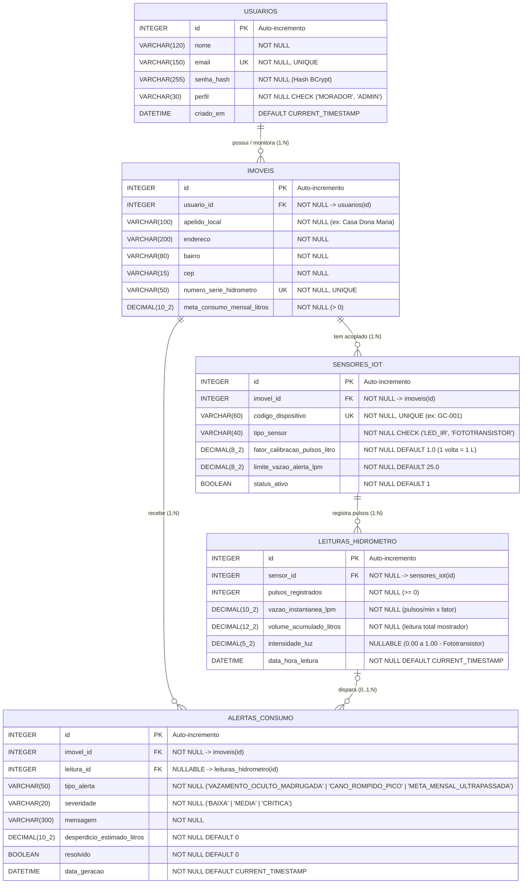

# Parte 1 de 6 — Banco de Dados Relacional (2,0 Pontos)
**Projeto Gota Certa — Telemetria Acessível para Hidrômetros Convencionais**
*Responsável: Antônio Aloísio Schappo Neto (RM556429)*

---

## 1. Diagrama Entidade-Relacionamento (DER — 0,5 pt)

O modelo relacional segue **exatamente as 5 tabelas definidas na Página 13 do Guia do Grupo**, projetado na **Terceira Forma Normal (3FN)** e focado 100% no acoplamento óptico não-invasivo (`LED_IR` + `FOTOTRANSISTOR`) sobre a relojoaria do hidrômetro:



---

## 2. Normalização (1FN, 2FN e 3FN) — "Saiba Responder" (Pág. 17)
* **1ª Forma Normal (1FN):** Todos os campos contêm apenas valores atômicos (indivisíveis) e não existem colunas repetidas ou arrays.
* **2ª Forma Normal (2FN):** Está na 1FN e todos os atributos não-chave dependem totalmente da chave primária (`id`) de sua respectiva tabela.
* **3ª Forma Normal (3FN):** Está na 2FN e nenhuma coluna não-chave depende de outra coluna não-chave (sem dependências transitivas: dados cadastrais do usuário ficam em `usuarios`, localização/meta do hidrômetro em `imoveis`, calibração óptica em `sensores_iot`, medições temporais em `leituras_hidrometro` e ocorrências em `alertas_consumo`).

---

## 3. Como Executar os Scripts SQL (0,5 pt + 1,0 pt)

```bash
sqlite3 /tmp/gotacerta_test.db < database/01_schema_seed.sql
sqlite3 -header -column /tmp/gotacerta_test.db < database/02_consultas_uso.sql
```
