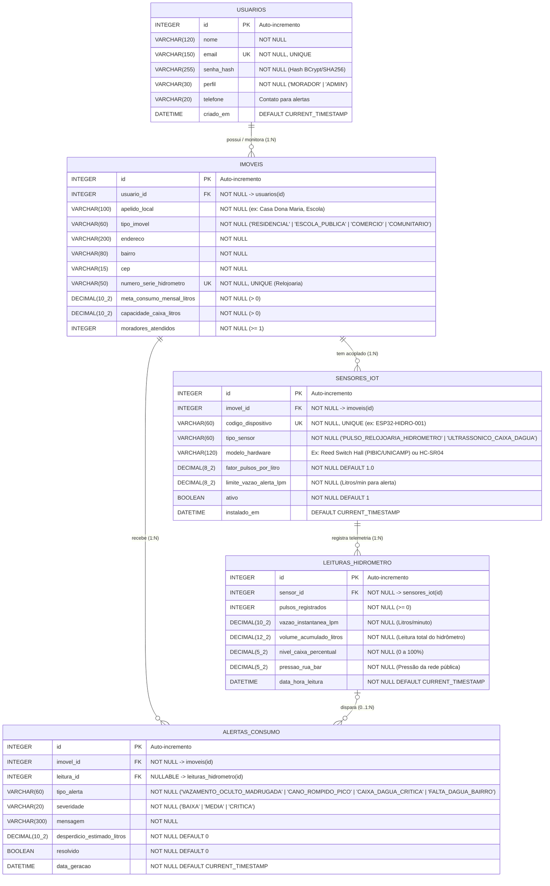

# Parte 1 de 6 — Banco de Dados Relacional (2,0 Pontos)
**Projeto GotaCerta — Telemetria Acessível para Hidrômetros e Combate ao Desperdício de Água**
*Responsável principal: Antônio Aloísio Schappo Neto (RM556429)*

---

## 1. Diagrama Entidade-Relacionamento (DER — 0,5 pt)

O modelo relacional do **GotaCerta** foi projetado na **Terceira Forma Normal (3FN)**, garantindo integridade referencial, ausência de redundâncias e aderência à regra *"Um domínio só: as entidades do banco são os recursos da API, e o app mobile consome essa API"*.



---

## 2. Regras de Negócio e Normalização

1. **1ª Forma Normal (1FN):** Todos os atributos são atômicos e não há grupos repetitivos ou listas multivaloradas em nenhuma coluna.
2. **2ª Forma Normal (2FN):** Todas as tabelas possuem chave primária simples (`id`) e todos os atributos não-chave dependem funcionalmente da chave primária inteira.
3. **3ª Forma Normal (3FN):** Não há dependências transitivas (ex.: dados do imóvel como `bairro` e `numero_serie_hidrometro` ficam em `imoveis`, dados técnicos do hardware de telemetria ficam em `sensores_iot`, e cada medição temporal fica em `leituras_hidrometro`).

---

## 3. Como Executar e Testar os Scripts SQL (0,5 pt + 1,0 pt)

### Opção A — Executando direto com SQLite3 (Nativo / Sem instalar servidor)
Na raiz do repositório, execute:

```bash
sqlite3 /tmp/gotacerta_test.db < database/01_schema_seed.sql
sqlite3 -header -column /tmp/gotacerta_test.db < database/02_consultas_uso.sql
```

### Opção B — Executando via Docker com MySQL 8
Ao subir `docker compose up -d mysql`, o arquivo `database/01_schema_seed_mysql.sql` é executado automaticamente na inicialização do container. Para rodar as consultas de uso:

```bash
docker exec -i gotacerta-mysql mysql -ugotacerta -pgotacerta123 gotacerta_db < database/02_consultas_uso.sql
```
